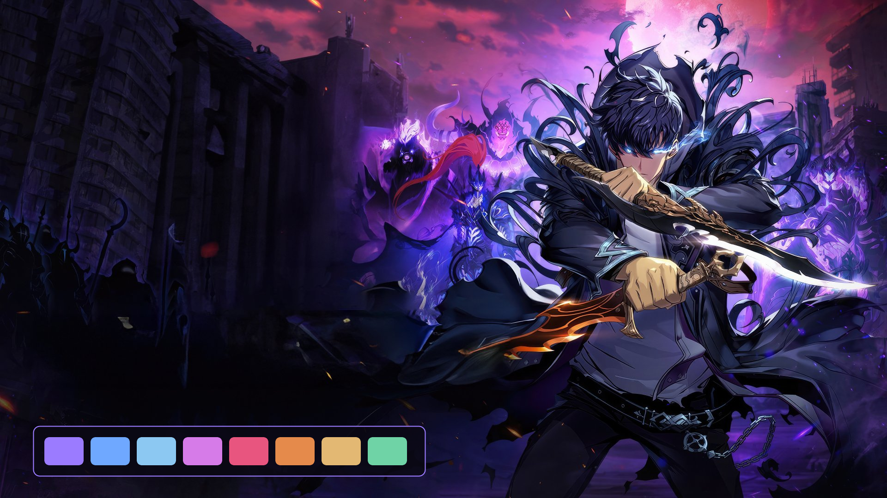
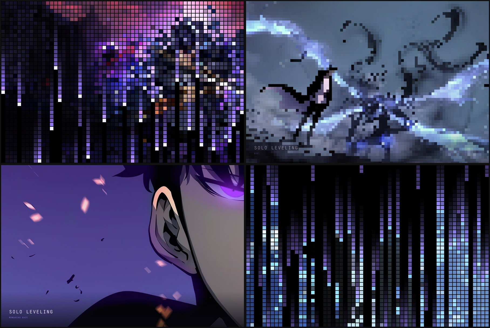

# Solo Leveling

A dark [Omarchy](https://omarchy.org) theme for the Shadow Monarch. The palette
is lifted from the wallpaper: shadow-soldier violet, the blue of Jinwoo's eyes,
a rose sky, and the gold and ember of his daggers, all over dungeon black.



## Install

```sh
omarchy theme install https://github.com/mcsmith3/omarchy-solo-leveling-theme
omarchy theme set solo-leveling
```

Or copy this directory to `~/.config/omarchy/themes/solo-leveling` and run the
second command.

## Palette

| Role | Colour | From |
| --- | --- | --- |
| Background | `#0A0814` | the dungeon wall in shadow |
| Foreground | `#E2DBF4` | moonlit lavender |
| Accent | `#9B7BFF` | shadow-soldier violet |
| Blue | `#6FA8FF` | Jinwoo's eyes |
| Cyan | `#8CC8F2` | the gleam on the blade |
| Magenta | `#D67BE8` | the rose sky |
| Red | `#E8557F` | Igris's plume |
| Orange | `#E58A4B` | the ember dagger |
| Yellow | `#E3B873` | the gold hilt and gloves |
| Green | `#6FD3A6` | a mana green, added for diffs and success states |

Window borders fade from violet into blue. Notifications are styled after the
System's status windows: navy panels with a blue edge.

## What's in here

- `colors.toml` — the palette; Omarchy generates the terminal, editor, btop,
  browser and shell colours from it
- `shell.notifications.toml` — the System-window notification style
- `icons.theme` — purple Yaru folder icons
- `backgrounds/` — nine wallpapers; cycle with `omarchy theme bg next`
- `screensaver/` and `scripts/` — the optional pixel-rain screensaver

## Wallpapers

| File | Scene |
| --- | --- |
| `01-shadow-monarch.jpg` | Default. Jinwoo with both daggers, his army behind him. |
| `02-arise.jpg` | Jinwoo and the shadows under a red moon, with the title logo. |
| `03-monarchs-gaze.jpg` | Close on a glowing violet eye. Quiet, good behind windows. |
| `04-shadow-army.jpg` | The shadow soldiers advancing at dusk. |
| `05-igris.jpg` | Igris's helm in violet flame. |
| `06-duel.jpg` | Jinwoo facing a shadow across streams of blue light. |
| `07-awakening.jpg` | Blue mana flaring around Jinwoo in the dark. |
| `08-hunter.jpg` | Jinwoo in a suit, wrapped in shadow and blue aura. |
| `09-violet-storm.jpg` | A close portrait against violet lightning. |

Add your own to `backgrounds/` and they join the cycle. Re-run the screensaver
installer afterwards and they join that too.

## Pixel-rain screensaver

This is optional. Each wallpaper is built by falling columns of violet pixels
that lay the scene down as coarse blocks. The blocks sharpen into the full
image, which holds for 12 seconds, then pixelates again and rains off the
screen before the next scene arrives.



```sh
python3 ~/.config/omarchy/themes/solo-leveling/scripts/install-screensaver.py --check
python3 ~/.config/omarchy/themes/solo-leveling/scripts/install-screensaver.py
omarchy restart shell
SOLO_PREVIEW_SECONDS=30 ~/.local/share/omarchy-solo-leveling/launch-screensaver --preview
```

`--check` changes nothing and reports whether your Omarchy version is
supported. The installer clones Omarchy's idle plugin so that it starts
`~/.local/share/omarchy-theme-screensaver/launch-screensaver`, which runs this
screensaver while Solo Leveling is the active theme and Omarchy's stock one
otherwise. It backs up what it replaces under
`~/.local/state/omarchy/backups/`. Restart the shell after the first install so
the idle service picks up the change.

Any key, click or mouse movement dismisses it. Timing is in
`screensaver/shell.qml` and the effect is in `screensaver/pixel-rain.frag`.
After editing the shader, rebuild it:

```sh
/usr/lib/qt6/bin/qsb --glsl '100 es,120,150' --hlsl 50 --msl 12 \
  -o screensaver/pixel-rain.frag.qsb screensaver/pixel-rain.frag
```

## Credits

Started from a palette extracted with [Aether](https://github.com/bjarneo/aether).
The wallpapers were collected from [Wallhaven](https://wallhaven.cc) and are
the work of their original artists and studios. Solo Leveling and its artwork
belong to their respective owners. This is an
unofficial fan theme, not affiliated with or endorsed by them.
